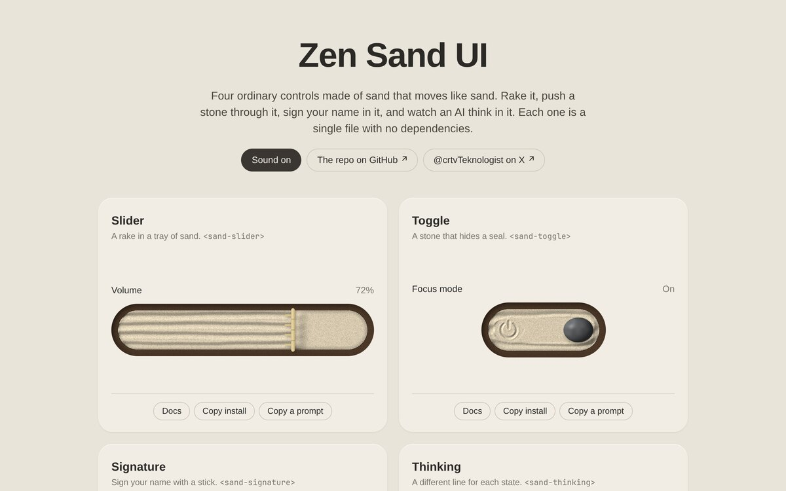

# Zen Sand UI

Four ordinary UI controls made of sand that moves like sand. The slider is a rake that cuts grooves and pushes a little heap of sand ahead of it. The toggle is a stone that glides along its tray and uncovers a symbol it was hiding. The AI thinking state rakes a different line for each thing the agent does. The sand is simulated, not drawn: every groove, heap and ripple is a height field that slumps to its angle of rest, lit on the GPU.

Each one is a single file that defines a custom element, with the sand engine and its recorded sounds inside it, so there is nothing else to fetch. No dependencies, no build step for you, MIT licensed.



## The four

| | element | what it does |
|---|---|---|
| [Slider](slider/) | `<sand-slider>` | A bamboo rake. Drag it right and its tines cut four grooves; pull it back and it drags the sand flat. |
| [Toggle](toggle/) | `<sand-toggle>` | A river stone. Switch it on and it glides along, leaving a wake, and uncovers the power symbol it had pressed into the sand. |
| [Signature](signature/) | `<sand-signature>` | Sign with a stick that cuts like a brush. You get the signature back as ink on a transparent PNG. |
| [Thinking](thinking/) | `<sand-thinking>` | An AI agent's working state: a rock in sand that rakes itself, with a different line for thinking, searching, using a tool and writing. |

## The look

A tray of fine pale sand in a dark walnut frame, seen from straight above, lit from the upper left. Everything is drawn in code: the sand is a height field one cell per CSS pixel, carved by the controls and lit by a WebGL2 shader, so grooves have a shadowed wall and a bright one. Stones are drawn in the same shader so they sit in the sand. The only image is the thinking state's rock, which was generated and cut out.

Each control makes sounds: a rake through sand, a stone set down, sand settling, a swish for each spoke the thinking state draws. They are ElevenLabs recordings, inside each file.

## Try them

Live: https://zen-sand-ui.vercel.app

Or run it yourself:

```sh
python3 -m http.server 8000     # from this folder
# open http://localhost:8000/
```

That opens the gallery, with all four live.

## Use one

Each is a single file that defines an element. Install it with the shadcn CLI, which puts the file in `public/zen-sand-ui/`:

```sh
npx shadcn add finktheartist/zen-sand-ui/slider
npx shadcn add finktheartist/zen-sand-ui/toggle
npx shadcn add finktheartist/zen-sand-ui/thinking
npx shadcn add finktheartist/zen-sand-ui/signature
```

Or copy the file into your project by hand. Then load it with a plain script tag and use its element:

```html
<script src="slider.js"></script>
<sand-slider value="40" label="Volume"></sand-slider>

<script src="toggle.js"></script>
<sand-toggle label="Focus mode"></sand-toggle>

<script src="thinking.js"></script>
<sand-thinking state="thinking"></sand-thinking>   <!-- then el.state = 'searching', 'tool', 'writing' or 'idle' -->
```

Each folder's README lists the attributes, properties and events. The slider, toggle and signature work inside a `<form>` like native controls.

- **Size.** Give the element a CSS `width` and the height follows. The sand is simulated at one cell per CSS pixel, so a wider tray costs more.
- **Sound.** It plays after the first touch or key on the page. `ZenSand.Sound.on = false` silences every control.
- **How the files share.** Each file carries a copy of the engine (about 18 KB) and its own sounds. The first one loaded sets `window.ZenSand` and the others reuse it. The files are between 170 and 370 KB; the thinking state is the big one, with two sound loops and the rock.

For agents, [llms.txt](llms.txt) lists every file and what it is. In the gallery each control has its install line and a "Copy a prompt" button; the prompt points a coding agent at the real file and tells it how to wire it in.

## Make your own

`skills/zen-sand-ui/` is how these were made, written as a skill for a coding agent. Install it with:

```sh
npx skills add finktheartist/zen-sand-ui
```

Or copy the folder into your agent's skills folder by hand (for Claude Code, `~/.claude/skills/`). It has:

- `SKILL.md`, the engine's API and the rules: keep the sand's volume, give each control one surprising idea, test on a slowed CPU.
- `core.js`, the engine every control is built on.
- `starter.html`, the smallest whole example: a tray you draw in with your finger.
- `look.mjs`, which opens a page with the CPU slowed four times, photographs an element at chosen moments and reports frame times.

[making-of/](making-of/) is how the set went from a still to four simulated controls: the concept sheets, every image and sound prompt, and the notes that changed each control.

## Working on this repo

- `core.js` is the source of the shared engine. After editing it, or anything in `sounds/` or `art/`, run `node tools/build.mjs`, which stamps the engine and each control's sounds into every control file (between the `// >>> zen sand core`, `// >>> sounds` and `// >>> art` markers) and into the skill. `node tools/build.mjs --check` exits 1 if any file is out of date.
- `sounds/` holds the trimmed takes: one-shots as MP3, loops as WAV (an MP3's padding would click at the loop point). `tools/build.mjs` lists which control plays which.
- `tools/spec.mjs` says what each control is. `node tools/docs.mjs` writes every folder's `README.md` and `index.html`, `registry.json` and `llms.txt` from it, so edit the spec and not those files.
- `node tools/test.mjs http://localhost:8000/gallery/` drives every control with real touch and key events at phone width, checks form values, scaling and sideways scroll, and exits 1 on a failure. `node tools/shot.mjs URL OUT W H SCALE` takes a full-page screenshot. Both need Chrome or Chromium (`CHROME=...` if it is somewhere unusual).

## Limits

- **Checked in headless Chromium** with real touch and key events, and with the CPU slowed four times (60 frames a second for each control). Not yet tried in Safari or Firefox, on a real phone, or with a screen reader.
- **Needs WebGL2.** Without it a control still works with keys, but nothing is drawn.
- **About sixteen at once.** Each element is its own WebGL canvas, and browsers keep only about sixteen alive.
- **It keeps moving for `prefers-reduced-motion`.** The sand is the control; there is no still version yet.
- **Drawn for a light page.**

## License

MIT. See [LICENSE](LICENSE). The thinking state's rock and the concept sheets in `making-of/` were generated with GPT Image (through Higgsfield) for this project. The sounds were generated with ElevenLabs for this project.
