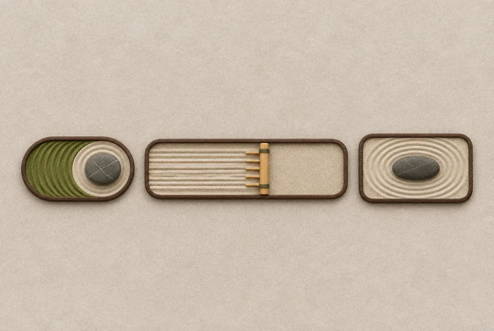
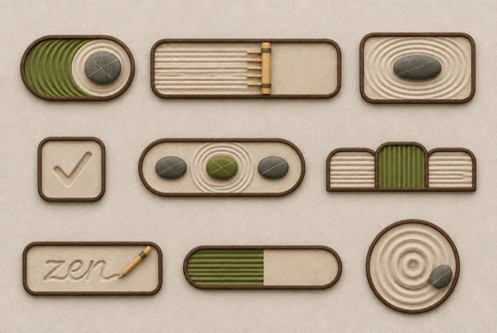
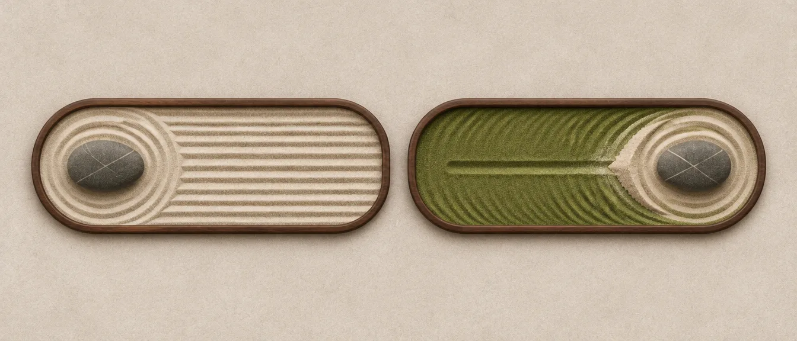
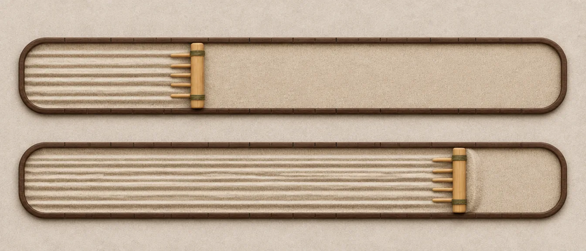
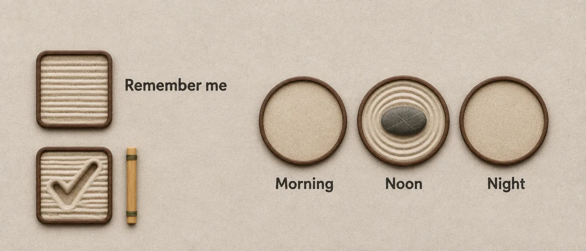
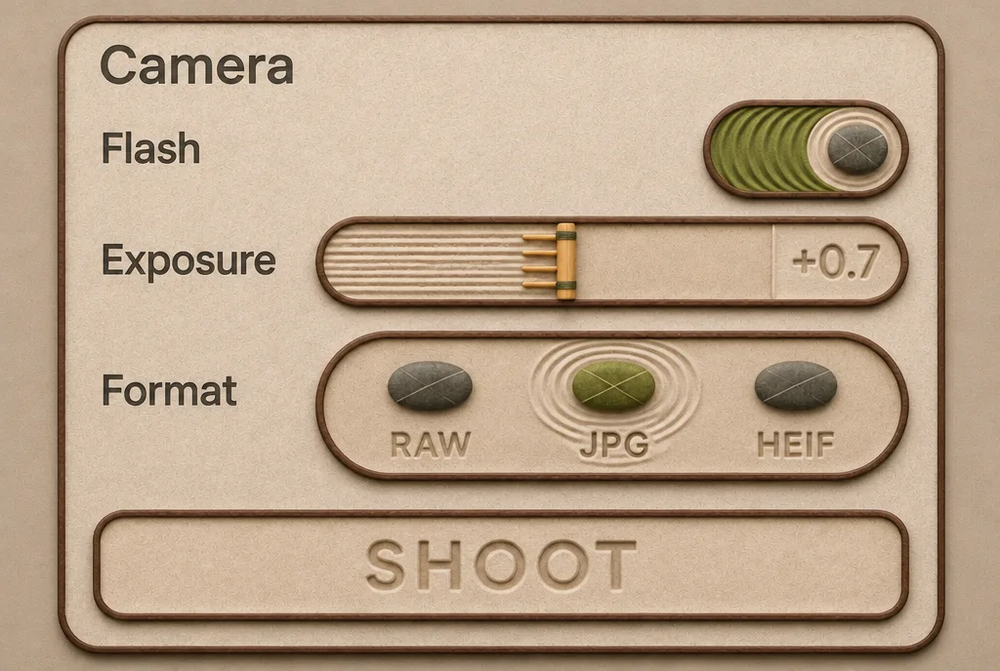
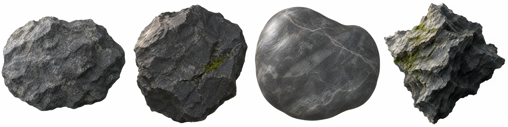

# How it was made

Zen Sand UI started as one of ten themes for a new set of controls, each tried as a single still: a toggle, a slider and a button. Sand won because of one line in its pitch: the control keeps a record of your hand. Grooves stay until you rake them smooth. Every prompt is in [prompts.md](prompts.md).

## 1. The still and the sheets

Then concept sheets for every control and its states, all with that still as the image reference, so they share one look. They show more controls than were built (tabs, a checkbox, a progress bar); they were for deciding the look, not a plan.

| | |
|---|---|
|  |  |
|  |  |

A second model reviewed the sheets and caught two things: the labels sat on top of the sand like stickers, and the example panel was a meditation app, the most obvious place sand could go. The labels became cuts in the sand and the panel became a camera's settings.

None of the images is used in the controls. The sand, the stones, the rake and the frames are all drawn in code, so they can move.

## 2. Making the sand move

The first slider drew a rake over a picture of grooves. The note on it was "Can we make it more fluid", and fluid had to mean sand that moves like sand. So the tray became a simulation:

- **A height field,** one number per pixel for how high the sand is there.
- **Tools carve it.** The rake's four tines cut grooves, and the sand they take out is pushed ahead as a little heap. Nothing disappears: what leaves a groove lands beside it or ahead of it.
- **It slumps.** Every frame, sand steeper than its angle of rest slides downhill, so a heap left behind settles into a soft mound.
- **The light is computed,** not painted: a WebGL2 shader reads the heights and lights them from the upper left, so a groove has a shadowed wall and a bright one.

The next note was "It moves very slow and laggy". Lighting every pixel in JavaScript ran at about 20 frames a second on a CPU slowed four times. Moving the light to the GPU and simulating at one cell per CSS pixel (not per screen pixel) brought it to 60. Every control since was measured the same way before it was shown.

## 3. Each control needed one idea

The toggle's first version slid a stone along a furrow, threw rings of sand round it at the end and turned the sand green for on. The note was "The sand moves weird", and what he wanted instead: a gentle push that leaves a wake, no colour change, and a symbol that isn't there when it's off. So the stone became a seal. It has pressed a power symbol into the sand where it rests, hiding it; switching on uncovers it.

A button came next, and showed the rule. A stone that sank when pressed was "kind of lame". A seal stamping its label was better but "still not creative". The lesson: a believable motion is not enough. Each control needs one thing sand does that you don't expect from a control. A button and a radio group were built and then left out of the set.

The signature pad was his idea: sign your name with a stick. It writes like a brush (slow is wide, fast is thin, a pen's pressure widens it), and what you get back is ink on a transparent PNG, not a picture of sand.

## 4. The thinking state

His brief: "a sand circle around a rock, (rock should probably be generated. The sand should react and build up dynamically". Four rocks were generated from above, lit from the same side as the sand, and cut out of their white backgrounds. The rock's outline becomes a mask the sand can't move into and a shape the rings bend round.

Then: "Can you have different states make different types of lines". Thinking draws closed rings; searching draws spokes, each a golden angle (about 137.5°) round from the last, so it never looks in the same place twice; using a tool draws the lines of water flowing past a stone, from the equation for flow round a cylinder, bent to the rock's real outline; writing draws dashes like lines of text. Keeping each state's lines under the next one's sounded good, but the tool's lines cover the whole tray and buried everything after them, so the sand sweeps itself smooth between states.

Last: "lets not use the rake. just the sand being dragged by an invisible rake". The rake and the stick went, and with them the wooden taps. Each state got its own recorded sound instead: a slow circular hiss for thinking, a swish per spoke for searching, a steady rush for the tool, a tiny scratch per word for writing.

## 5. Sounds

Every sound is an ElevenLabs sound effect: four takes of each prompt, the steadiest or cleanest kept, trimmed, and for loops, the tail cross-faded into the head so they repeat without a seam. They are inside each control's file as data, so there is nothing else to fetch.
